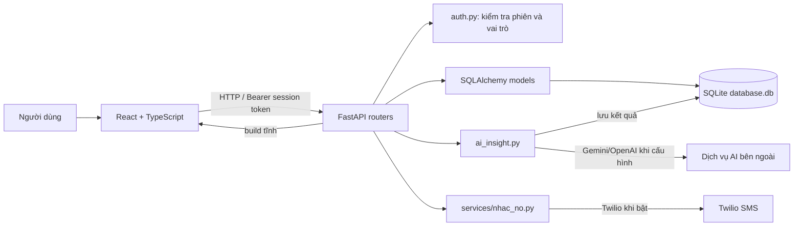

# Kiến trúc hiện tại — Hệ thống quản lý điện nước

## Tổng quan

## Ranh giới module

- `frontend/src/components/` hiển thị giao diện và gọi API. `App.tsx` giữ trạng thái đăng nhập ở phía client và chọn tab theo vai trò.
- `backend/main.py` tạo FastAPI app, đăng ký middleware/router, tạo bảng lúc startup, lập lịch nhắc nợ và phục vụ bản build giao diện.
- `backend/routers/` thực hiện kiểm tra request, gọi SQLAlchemy và trả dữ liệu cho frontend. `auth.py` cung cấp dependencies `require_login` và `require_admin`.
- `backend/database.py` là nơi khai báo engine, session và model ORM. `schemas.py` xác thực payload và mô tả response.
- `backend/services/nhac_no.py` cô lập việc chọn hóa đơn quá hạn và gửi SMS qua Twilio.
- `backend/routers/ai_insight.py` hiện gom prompt, chọn provider, fallback cục bộ, truy xuất lịch sử, phân loại cảnh báo, lưu kết quả và các endpoint AI. Đây là file có nhiều trách nhiệm; đọc đúng luồng đang sửa trước khi tách module.

## Luồng đăng nhập và phân quyền

1. Frontend gửi username/password đến `POST /auth/login`.
2. Backend đối chiếu hash trong bảng `NguoiDung`, tạo token ngẫu nhiên và lưu thông tin user trong dictionary `sessions` ở tiến trình.
3. Frontend lưu token trong `localStorage` và gửi `Authorization: Bearer ...` cho các request tiếp theo.
4. Router dùng `require_login`, `require_admin` hoặc kiểm tra `ma_ho` để giới hạn dữ liệu theo hộ.

Frontend chỉ hỗ trợ trải nghiệm đăng nhập. Quyền truy cập dữ liệu phải được thực thi ở backend.

## Luồng ghi chỉ số và lập hóa đơn

`POST /chi-so/` xác thực chỉ số, kiểm tra đồng hồ, lưu bản ghi `ChiSoTieuThu`, tính lượng dùng từ hai chỉ số và đơn giá, sau đó tạo hoặc cập nhật hóa đơn kỳ tương ứng. Ngoại lệ thay đồng hồ được biểu diễn bằng trường `ThayDongHo`; không bỏ qua validator hiện tại khi sửa logic.

## Luồng AI

- Phân tích hóa đơn: endpoint kiểm tra hóa đơn và quyền của user, gom riêng điện/nước trong tối đa 3 kỳ đến kỳ hóa đơn, tạo nhận xét bằng Gemini/OpenAI hoặc fallback cục bộ, phân loại cảnh báo bằng quy tắc code và lưu/cập nhật `PhanTichAI`.
- Hỏi đáp: backend kiểm tra quyền theo hộ, lấy tối đa 12 bản ghi chỉ số gần nhất cùng dữ liệu hóa đơn gắn theo kỳ, ghép chúng với câu hỏi tự do rồi gọi provider. Gemini được cấu hình Google Search cho câu hỏi cần nguồn mới; response có thể chứa danh sách nguồn.
- Dữ liệu truy xuất không thêm tên, số điện thoại hay mã phòng vào prompt. Tuy vậy, câu hỏi tự do là nội dung do người dùng nhập và cũng được gửi tới provider khi API ngoài được cấu hình; không khuyến khích nhập thông tin cá nhân vào câu hỏi.
- Khi thiếu khóa hoặc provider không dùng được, code có thể trả lời bằng logic cục bộ. Không giả định mọi response đều do LLM tạo.

Đặc tả quan sát được và các giới hạn hiện tại được ghi trong `specs/ai-insight.md`.

## Nhắc nợ

`main.py` chạy một tác vụ nền mỗi ngày lúc 09:00 theo giờ Việt Nam. `services/nhac_no.py` chọn hộ còn hóa đơn chưa thanh toán đủ hạn, kiểm tra `LogNhacNo`, đổi số Việt Nam sang E.164 và chỉ gọi Twilio khi cấu hình `SMS_ENABLED` cùng thông tin Twilio hợp lệ.

## Quy tắc giữ kiến trúc

- Giữ phép tính tiền, trạng thái thanh toán, xác thực và phân quyền ở backend; không giao các quyết định này cho prompt.
- Giữ API key ở môi trường backend (`.env` cục bộ, `.env.example` chỉ có placeholder); không đưa key sang bundle frontend.
- Chỉ gửi dữ liệu tối thiểu cho provider AI và không đưa định danh hộ vào payload.
- Nếu sửa trường ORM, kiểm tra schema hiện có và cách nâng cấp DB. `create_all()` không tự bổ sung cột vào bảng SQLite đã tồn tại.
- Khi thêm API, cập nhật component gọi API, schema, kiểm thử và tài liệu liên quan trong cùng thay đổi.
